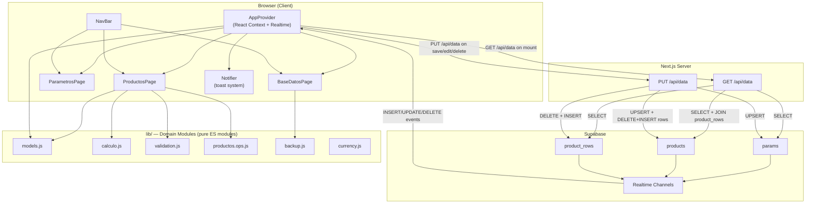
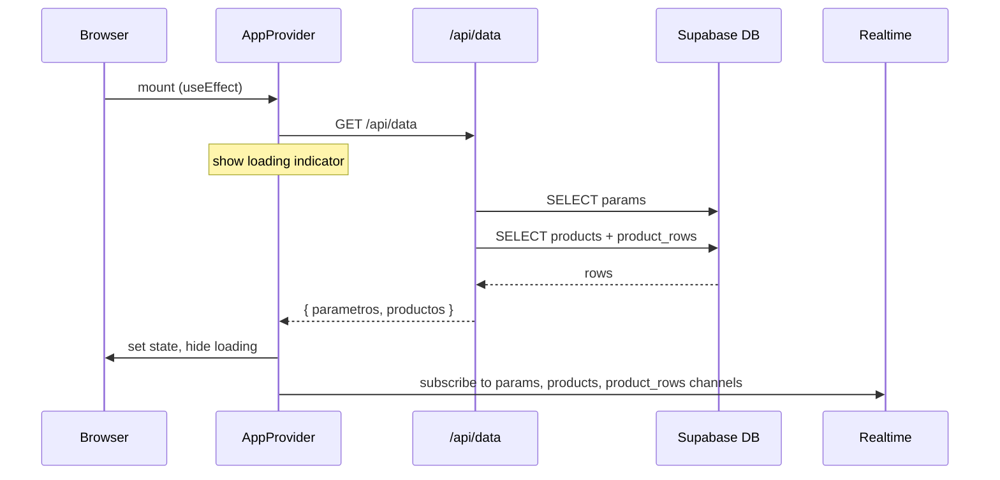

# Design Document — Next.js Migration (`nextjs-migration`)

## Overview

This document describes the technical design for migrating the Limpiapipas price-calculator application from a JavaScript-vanilla SPA (loaded with `<script>` tags under `file://`) to a Next.js 14+ App Router project backed by Supabase for persistent, real-time data synchronization.

### Goals

- Replace `localStorage` persistence with Supabase relational tables (`params`, `products`, `product_rows`).
- Replace IIFE/`window.LP` modules with standard ES modules (`export`/`import`).
- Replace DOM controllers with React components.
- Keep all domain logic (calculation, validation, models, operations) identical — only the delivery mechanism changes.
- Preserve all existing unit and property-based tests, adapting imports to the ES module form.

### Non-Goals

- No TypeScript is introduced; JavaScript throughout.
- No server-side rendering of data-dependent pages beyond initial shell; all data fetching is client-side.
- No authentication / multi-tenancy in this migration.

### Key Decisions

| Decision | Rationale |
|---|---|
| App Router with `"use client"` components for interactive pages | Keeps familiar React patterns; server components only for layout/static shell |
| `PUT /api/data` sends full snapshots (all `parametros` + `productos`) | Matches original `repository.replaceAll` semantics; avoids diff/patch complexity |
| Realtime re-reads full state on any event | Simplest correct approach; avoids partial-update inconsistencies across 3 tables |
| Backup import does direct Supabase upsert, then re-reads manually | Avoids depending on Realtime latency to confirm import success |
| `lib/` for domain modules, `components/` for React, `app/api/` for routes | Next.js conventions; keeps domain logic portable and testable without React |

---

## Architecture

### System Architecture Diagram



### Data Flow — Normal Operations

```mermaid
sequenceDiagram
    participant User
    participant Component
    participant AppProvider
    participant APIRoute as /api/data
    participant SupabaseDB as Supabase DB
    participant Realtime

    User->>Component: save / edit / delete
    Component->>AppProvider: setParametros / setProductos (optimistic)
    AppProvider->>APIRoute: PUT /api/data { parametros, productos }
    APIRoute->>SupabaseDB: UPSERT params, products; DELETE+INSERT product_rows
    SupabaseDB-->>APIRoute: ok
    APIRoute-->>AppProvider: HTTP 200
    SupabaseDB->>Realtime: broadcast INSERT/UPDATE/DELETE events
    Realtime-->>AppProvider: event received → re-read full state
    AppProvider->>APIRoute: GET /api/data
    APIRoute->>SupabaseDB: SELECT params, products, product_rows
    SupabaseDB-->>APIRoute: rows
    APIRoute-->>AppProvider: { parametros, productos }
    AppProvider->>Component: re-render with canonical state
```

### Data Flow — Initial Load



---

## Components and Interfaces

### Directory Structure

```
app/
  layout.js                   ← Root layout: imports Bootstrap CSS, app.css, AppProvider, NavBar
  page.js                     ← Redirect to /productos
  api/
    data/
      route.js                ← GET and PUT handlers
  (pages)/
    productos/
      page.js                 ← <ProductosPage />
    parametros/
      page.js                 ← <ParametrosPage />
    base-datos/
      page.js                 ← <BaseDatosPage />
lib/
  calculo.js
  currency.js
  validation.js
  models.js
  productos.ops.js
  backup.js
  supabase.js                 ← createClient initialization
  db.js                       ← getData(), putData(), importBackup()
components/
  NavBar.js
  AppProvider.js
  Notifier.js
  NotifierContext.js          ← React context for toast dispatch
  productos/
    ProductosPage.js
    Calculadora.js
    EditorDeLineas.js
    ListaProductos.js
    VentanaDetalle.js
    VentanaEdicion.js
  parametros/
    ParametrosPage.js
  base-datos/
    BaseDatosPage.js
public/
styles/
  app.css
tests/
  calculo.test.js
  currency.test.js
  validation.test.js
  models.test.js
  productos.ops.test.js
  backup.test.js
  api.test.js
  integration.test.js
old/                          ← original files preserved here
```

### `app/layout.js`

Root layout. Imports Bootstrap CSS and `styles/app.css` globally. Wraps children in `<AppProvider>` and renders `<NavBar>`.

```js
// Responsibilities:
// - Import 'bootstrap/dist/css/bootstrap.min.css'
// - Import 'bootstrap-icons/font/bootstrap-icons.css'
// - Import '../styles/app.css'
// - Render <html><body><AppProvider><NavBar />{children}</AppProvider></body></html>
// - "use client" is NOT used here (layout is a Server Component)
// Note: Bootstrap JS bundle imported inside a client component (NavBar or AppProvider)
//       via useEffect to avoid SSR issues.
```

### `app/page.js`

```js
// Server component. Redirects to /productos using Next.js redirect().
import { redirect } from 'next/navigation';
export default function Home() { redirect('/productos'); }
```

### `app/api/data/route.js`

Handles `GET /api/data` and `PUT /api/data`. Uses the Supabase server client.

```js
// GET /api/data
// - Read all rows from params → map to Parametro[]
// - Read all rows from products → for each, read product_rows where product_id = product.id
// - Map snake_case → camelCase (precio_unitario→precioUnitario, etc.)
// - Apply normalizarProducto to each Producto
// - Return HTTP 200 { parametros, productos }
// - On Supabase error: HTTP 500 { error: "..." }, log server-side

// PUT /api/data
// - Validate body: { parametros: Array, productos: Array } → HTTP 400 if invalid
// - Upsert each Parametro into params (conflict on id)
// - For each Producto:
//   - Upsert record into products (conflict on id)
//   - DELETE FROM product_rows WHERE product_id = producto.id
//   - INSERT new rows into product_rows
// - Return HTTP 200 on success
// - On Supabase error: HTTP 500 { error: "..." }
```

**Column mapping** (`snake_case` DB ↔ `camelCase` JS):

| DB column | JS field |
|---|---|
| `precio_unitario` | `precioUnitario` |
| `precio_total` | `precioTotal` |
| `parametro_id` | `parametroId` |
| `fuente_de_componente` | `fuenteDeComponente` |
| `producto_componente_id` | `productoComponenteId` |
| `product_id` | *(internal join key, not exposed)* |

### `lib/supabase.js`

```js
// Validates env vars at module load time; throws descriptive error if missing.
// Exports: createSupabaseClient() → SupabaseClient
// Uses: NEXT_PUBLIC_SUPABASE_URL, NEXT_PUBLIC_SUPABASE_PUBLISHABLE_KEY
```

### `lib/db.js`

Pure async functions wrapping Supabase calls. Used by both API routes and the backup import flow.

```js
// Exports:
//   getData(supabaseClient) → Promise<{ parametros: Parametro[], productos: Producto[] }>
//   putData(supabaseClient, { parametros, productos }) → Promise<void>
//   importBackup(supabaseClient, { parametros, productos }) → Promise<void>
//     - same as putData but called directly from BaseDatosPage
//     - after upsert completes, caller re-reads via getData (no Realtime dependency)
```

### `components/AppProvider.js`

`"use client"` component. Root React Context provider. Owns the global state (`parametros`, `productos`) and manages Realtime subscriptions.

```js
// State:
//   parametros: Parametro[]
//   productos: Producto[]
//   loading: boolean
//   error: string | null

// On mount (useEffect):
//   1. Call getData() → set loading=true, populate state, set loading=false
//   2. Subscribe to Supabase Realtime channels for params, products, product_rows
//      - On any INSERT/UPDATE/DELETE event: call getData() → update state

// On unmount: unsubscribe all Realtime channels

// Context value exposed:
//   { parametros, setParametros, productos, setProductos, loading, error,
//     saveAll }
//   saveAll({ parametros, productos }):
//     - Optimistic update: setParametros / setProductos immediately
//     - Call putData()
//     - On failure: revert to previous state, notify error

// Exported: AppContext (React.createContext), AppProvider (component)
```

### `components/NotifierContext.js` + `components/Notifier.js`

```js
// NotifierContext: React context with dispatch({ type: 'info'|'error', message })
// Notifier: renders Bootstrap dismissible alerts stacked at top of page
//   - info alerts auto-dismiss after 5000ms
//   - error alerts persist until user closes
//   - Accessible: role="alert", aria-live="polite"
```

### `components/NavBar.js`

`"use client"` component. Renders Bootstrap navbar with three nav items (Productos, Parámetros, Base de datos). Uses Next.js `usePathname` to apply `active` class to the current page link. Uses Next.js `<Link>` for client-side navigation.

```js
// Props: none
// State: none (reads current path from usePathname())
// Renders: <nav> with three <Link> items → /productos, /parametros, /base-datos
// Active class applied when pathname starts with the item's path
// Imports Bootstrap JS bundle via useEffect for dropdown/collapse support
```

### `components/productos/ProductosPage.js`

`"use client"` component. Two-column layout (≥1024px) or single-column (< 1024px) using Bootstrap grid.

```js
// Reads from AppContext: parametros, productos, saveAll
// Reads from NotifierContext: dispatch
// Local state:
//   nombreProducto: string
//   lineas: LineaEnEdicion[]      ← managed by EditorDeLineas
//   resultado: { subtotales, total } | null
//   direccionOrden: 'ascendente' | 'descendente'
//   modalDetalle: Producto | null
//   modalEdicion: Producto | null

// Renders:
//   <div class="row">
//     <div class="col-lg-6"> <Calculadora /> </div>
//     <div class="col-lg-6"> <ListaProductos /> </div>
//   </div>
```

### `components/productos/Calculadora.js`

```js
// Props:
//   parametros: Parametro[]
//   productos: Producto[]
//   onGuardar: (nombre, lineas) => void
// Local state:
//   nombre: string
//   lineas: LineaEnEdicion[]   ← delegated to EditorDeLineas via ref or lifted state
//   resultado: { subtotales, total } | null

// Handlers:
//   handleCalcular(): validates name + lines, calls productosOps.calcularContenedor,
//                     sets resultado
//   handleGuardar(): validates, calls models.crearProducto, calls onGuardar,
//                    resets form (nombre='', lineas=[], resultado=null)
```

### `components/productos/EditorDeLineas.js`

`"use client"` component. Controlled component managing the array of `LineaEnEdicion` objects.

```js
// Props:
//   lineas: LineaEnEdicion[]
//   onChange: (lineas: LineaEnEdicion[]) => void
//   parametros: Parametro[]
//   productos: Producto[]
//   idProductoContenedor: string | null   ← to exclude from product selector

// LineaEnEdicion shape:
//   { parametroId: string|null, cantidad: string,
//     fuenteDeComponente: 'Parámetro'|'Producto',
//     productoComponenteId: string|null }

// Renders: one row per linea with:
//   - <select> Fuente (Parámetro | Producto)
//   - <select> Componente (Parametros list OR Productos list filtered)
//   - <input type="number"> Cantidad
//   - <span> Unidad (read-only derived from selected component)
//   - <button> Eliminar (icon button)
// + "Agregar línea" button
// + Empty state "No hay líneas agregadas." when lineas.length === 0
```

### `components/productos/ListaProductos.js`

```js
// Props:
//   productos: Producto[]
//   direccionOrden: 'ascendente' | 'descendente'
//   onToggleOrden: () => void
//   onVerDetalle: (producto: Producto) => void
//   onEditar: (producto: Producto) => void
//   onEliminar: (productoId: string) => void

// Renders:
//   - Orden button (toggles direccionOrden)
//   - Bootstrap tabs: Tab_Compuestos | Tab_Simples
//   - Each tab panel: sorted list of productos filtered by compuesto flag
//   - Each item: nombre, Precio_Total badge, Precio_Sugerido→Precio_Redondeado badge,
//                three icon buttons (Ver detalle, Editar, Eliminar)
//   - Empty state for whole list and per-tab
```

### `components/productos/VentanaDetalle.js`

```js
// Props:
//   producto: Producto | null
//   parametros: Parametro[]
//   productos: Producto[]
//   onClose: () => void

// Renders: Bootstrap modal (show when producto !== null)
//   - Title: producto.nombre
//   - Body: list of resolved lines (productosOps.resolverDetalle)
//     - Each line: nombre componente, cantidad, unidad, subtotal en PEN
//     - Absent parametro: NOMBRE_PARAMETRO_AUSENTE
//     - Absent producto componente: NOMBRE_PRODUCTO_COMPONENTE_AUSENTE
//   - Footer: Precio_Total en PEN, Cerrar button
// No edit controls
```

### `components/productos/VentanaEdicion.js`

```js
// Props:
//   producto: Producto | null
//   parametros: Parametro[]
//   productos: Producto[]
//   onGuardar: (productoId, lineasActualizadas) => void
//   onClose: () => void

// Local state:
//   lineas: LineaEnEdicion[]    ← deep-copy of producto.lineas on open, via useEffect
//   saving: boolean

// Renders: Bootstrap modal (show when producto !== null)
//   - Title: "Editar: {producto.nombre}" (nombre read-only)
//   - Body: <EditorDeLineas lineas={lineas} onChange={setLineas} ... />
//   - Footer: Guardar (validates, calls onGuardar), Cancelar
// On Guardar: validates via validarLineasEnEdicion, calls productosOps.editarProducto
```

### `components/parametros/ParametrosPage.js`

`"use client"` component. Direct port of `parametros.controller.js`.

```js
// Reads from AppContext: parametros, setParametros, productos, saveAll
// Reads from NotifierContext: dispatch

// Local state:
//   nombre: string
//   precioUnitario: string
//   unidad: string
//   idEnEdicion: string | null

// Handlers:
//   handleSubmit(): validate → crearParametro or update → saveAll → notify
//   handleEditar(id): load values into form fields, set idEnEdicion
//   handleEliminar(id): count references in Calculadora state, confirm, 
//                        desreferenciar, remove, saveAll

// Note: "referencias en Calculadora" — ProductosPage must expose a ref-counting
// function, or this check is simplified to 0 since the Calculadora state is 
// local to ProductosPage. See design note below.
```

> **Design note on desreferenciación**: In the original app, `parametros.controller` called `productosController.contarLineasQueReferencian` to warn the user before deleting a param that is in use in the current Calculadora editing session. In the React version, the `lineas` state of `Calculadora` is lifted to `ProductosPage`. `ParametrosPage` cannot directly access it. Two options: (a) lift Calculadora state further up to `AppProvider`, or (b) use a React ref/callback registered at mount time. **Chosen approach**: expose the current Calculadora `lineas` via a shared atom in `AppContext` (`calculadoraLineas`, `setCalculadoraLineas`). This is a small addition to the context that preserves the original UX without complex prop drilling. When a param is deleted from `ParametrosPage`, any `calculadoraLineas` entries with that `parametroId` have it set to `null` before the delete is persisted.

### `components/base-datos/BaseDatosPage.js`

`"use client"` component. Port of `basedatos.controller.js`.

```js
// Reads from AppContext: parametros, productos, setParametros, setProductos
// Reads from NotifierContext: dispatch

// Handlers:
//   handleExportar(): backup.serializarRespaldo → Blob → URL.createObjectURL → <a>.click
//   handleImportar(file): FileReader.readAsText → backup.parsearRespaldo
//     - status "invalid": dispatch error
//     - status "ok": confirm → importBackup(supabase, data) [upsert por id: existe→update, no existe→insert]
//                    → getData() → setParametros/setProductos
//                    → dispatch info "Datos importados correctamente."
//     - On Supabase failure: dispatch error toast indicating the save to Supabase failed;
//                            DO NOT replace global state with imported data (keep previous state)

// Renders:
//   - Exportar button
//   - <input type="file" accept="application/json"> for import
```

---

## Data Models

### Supabase Table Schemas

#### `params`
```sql
CREATE TABLE params (
  id            UUID PRIMARY KEY DEFAULT gen_random_uuid(),
  nombre        TEXT NOT NULL,
  precio_unitario NUMERIC(15,2) NOT NULL,
  unidad        TEXT NOT NULL
);
ALTER TABLE params REPLICA IDENTITY FULL;
```

#### `products`
```sql
CREATE TABLE products (
  id           UUID PRIMARY KEY DEFAULT gen_random_uuid(),
  nombre       TEXT NOT NULL,
  precio_total NUMERIC(15,2) NOT NULL DEFAULT 0,
  unidad       TEXT NOT NULL DEFAULT 'UND',
  compuesto    BOOLEAN NOT NULL DEFAULT FALSE
);
ALTER TABLE products REPLICA IDENTITY FULL;
```

#### `product_rows`
```sql
CREATE TABLE product_rows (
  id                    UUID PRIMARY KEY DEFAULT gen_random_uuid(),
  product_id            UUID NOT NULL REFERENCES products(id) ON DELETE CASCADE,
  parametro_id          UUID REFERENCES params(id),
  cantidad              NUMERIC(15,2) NOT NULL,
  subtotal              NUMERIC(15,2) NOT NULL DEFAULT 0,
  fuente_de_componente  TEXT NOT NULL DEFAULT 'Parámetro',
  producto_componente_id UUID REFERENCES products(id)
);
ALTER TABLE product_rows REPLICA IDENTITY FULL;
```

> `REPLICA IDENTITY FULL` is required so that Supabase Realtime can broadcast `UPDATE` and `DELETE` events with the full old row data.

### Domain Entity Shapes (JavaScript)

```js
// Parametro
{ id: string, nombre: string, precioUnitario: number, unidad: string }

// Producto
{ id: string, nombre: string, lineas: LineaDeCalculo[],
  precioTotal: number, unidad: string, compuesto: boolean }

// LineaDeCalculo
{ parametroId: string|null, cantidad: number, subtotal: number,
  fuenteDeComponente: 'Parámetro'|'Producto',
  productoComponenteId: string|null }

// LineaEnEdicion (component state — cantidad is a raw string)
{ parametroId: string|null, cantidad: string,
  fuenteDeComponente: 'Parámetro'|'Producto',
  productoComponenteId: string|null }
```

### snake_case ↔ camelCase Mapping

Handled in `lib/db.js` `getData()`:

```js
// params row → Parametro
const toParametro = (row) => ({
  id:             row.id,
  nombre:         row.nombre,
  precioUnitario: Number(row.precio_unitario),
  unidad:         row.unidad,
});

// products row + product_rows rows → Producto
const toProducto = (row, rowLineas) => normalizarProducto({
  id:         row.id,
  nombre:     row.nombre,
  precioTotal: Number(row.precio_total),
  unidad:      row.unidad,
  compuesto:   row.compuesto,
  lineas:      rowLineas.map(toLinea),
});

// product_rows row → LineaDeCalculo
const toLinea = (row) => ({
  parametroId:          row.parametro_id,
  cantidad:             Number(row.cantidad),
  subtotal:             Number(row.subtotal),
  fuenteDeComponente:   row.fuente_de_componente,
  productoComponenteId: row.producto_componente_id,
});

// Parametro → params row for upsert
const fromParametro = (p) => ({
  id:              p.id,
  nombre:          p.nombre,
  precio_unitario: p.precioUnitario,
  unidad:          p.unidad,
});

// Producto → products row for upsert
const fromProducto = (p) => ({
  id:           p.id,
  nombre:       p.nombre,
  precio_total: p.precioTotal,
  unidad:       p.unidad,
  compuesto:    p.compuesto,
});

// LineaDeCalculo → product_rows row for insert
const fromLinea = (l, productId) => ({
  product_id:             productId,
  parametro_id:           l.parametroId,
  cantidad:               l.cantidad,
  subtotal:               l.subtotal,
  fuente_de_componente:   l.fuenteDeComponente,
  producto_componente_id: l.productoComponenteId,
});
```

### Domain Modules — ES Module Exports

Each `lib/` module is a direct port of its `src/` counterpart, replacing the IIFE wrapper with named `export` statements and removing all `window` references.

#### `lib/calculo.js`
```js
export function redondear2(n) { ... }
export function subtotalLinea(cantidad, precioUnitario) { ... }
export function precioTotal(subtotales) { ... }
export function calcularProducto(lineas) { ... }
```

#### `lib/currency.js`
```js
export function formatearPEN(n) { ... }
```

#### `lib/validation.js`
```js
export const MENSAJES = { ... }   // all exact error message strings
export const VALIDO = Object.freeze({ valido: true })
export function validarNombreParametro(nombre, existentes, idEnEdicion) { ... }
export function validarPrecioUnitario(valor) { ... }
export function validarUnidad(unidad) { ... }
export function validarNombreProducto(nombre) { ... }
export function validarCantidad(valor) { ... }
```

#### `lib/models.js`
```js
export const FUENTE_COMPONENTE = { PARAMETRO: 'Parámetro', PRODUCTO: 'Producto' }
export function generarId() { ... }
export function crearParametro(nombre, precioUnitario, unidad) { ... }
export function crearProducto(nombre, lineas, precioTotal, unidad = 'UND') { ... }
export function crearLinea(parametroId, cantidad, fuenteDeComponente, productoComponenteId) { ... }
export function normalizarLinea(linea) { ... }
export function normalizarProducto(producto) { ... }
export function esCompuesto(lineas) { ... }
```

#### `lib/productos.ops.js`
```js
import { FUENTE_COMPONENTE, esCompuesto } from './models.js'
import { calcularProducto, redondear2 }   from './calculo.js'
import { validarCantidad }                from './validation.js'

export const NOMBRE_PARAMETRO_AUSENTE          = 'Parámetro no disponible'
export const NOMBRE_PRODUCTO_COMPONENTE_AUSENTE = 'Producto no disponible'
export const UNIDAD_DE_REEMPLAZO               = 'UND'
export function resolverDetalle(producto, parametros, productos) { ... }
export function resolverPrecioUnitario(linea, parametros, productos) { ... }
export function calcularContenedor(lineas, parametros, productos) { ... }
export function editarProducto(productos, id, lineasProducto, parametros) { ... }
export function eliminarProducto(productos, id) { ... }
export function validarLineasProducto(lineas, productos, idEnEdicion) { ... }
export function detectarCicloComposicion(idContenedor, lineas, productos) { ... }
```

#### `lib/backup.js`
```js
export const BACKUP_VERSION = '1'
export function serializarRespaldo(parametros, productos) { ... }
export function parsearRespaldo(texto) { ... }
```

---

## Correctness Properties

*A property is a characteristic or behavior that should hold true across all valid executions of a system — essentially, a formal statement about what the system should do. Properties serve as the bridge between human-readable specifications and machine-verifiable correctness guarantees.*

### Property 1: Backup serialization round-trip preserves all data

*For any* arrays of parametros and productos that are JSON-serializable (including Productos with and without a `compuesto` boolean field), calling `parsearRespaldo(serializarRespaldo(parametros, productos))` SHALL return an object with `status === "ok"`, and the `parametros` and `productos` fields of that result SHALL be structurally equal to the original inputs — including any boolean `compuesto` values, `fuenteDeComponente` strings, and `productoComponenteId` values on each line.

**Validates: Requirements 11.7, 12.4**

---

### Property 2: Normalization functions are idempotent

*For any* Producto object (with or without the `compuesto` field), applying `normalizarProducto` twice SHALL produce a result structurally equal to applying it once. Likewise, *for any* LineaDeCalculo object (with or without `fuenteDeComponente` and `productoComponenteId`), applying `normalizarLinea` twice SHALL produce a result structurally equal to applying it once, with `fuenteDeComponente` always a non-null string and `productoComponenteId` always null or a string.

**Validates: Requirements 2.2, 12.1, 12.2, 12.3**

---

### Property 3: Producto partition is total and exclusive

*For any* array of Productos, the union of the `compuestos` and `simples` arrays produced by the partition function SHALL contain exactly the same elements as the input array (no element is lost or duplicated), every element in `compuestos` SHALL have `compuesto === true`, and every element in `simples` SHALL have `compuesto !== true`.

**Validates: Requirements 6.12, 2.2**

---

### Property 4: formatearPEN always produces exactly two decimal places

*For any* finite number `n`, `formatearPEN(n)` SHALL return a string that starts with `"S/ "` and whose numeric part contains exactly two digits after the decimal separator.

**Validates: Requirements 6.13, 2.6**

---

### Property 5: validarCantidad accepts exactly the valid domain range

*For any* number within [0.01, 999 999 999.99] with at most 2 decimal places, `validarCantidad` SHALL return `{ valido: true }`. *For any* number outside that range, or with more than 2 decimal places, `validarCantidad` SHALL return `{ valido: false }` with a non-empty `mensaje`.

**Validates: Requirements 6.7, 2.2, 2.6**

---

## Error Handling

### API Route Errors

| Scenario | Response |
|---|---|
| Missing/invalid `parametros` or `productos` in PUT body | HTTP 400 `{ error: "Se requieren los campos parametros y productos como arreglos." }` |
| Supabase read error in GET | HTTP 500 `{ error: "Error al leer los datos." }` (details logged server-side, not exposed to client) |
| Supabase write error in PUT | HTTP 500 `{ error: "Error al guardar los datos." }` |
| Missing env vars at startup | Throw at module load: `"Variable de entorno NEXT_PUBLIC_SUPABASE_URL no definida."` |

### Client-Side Error Handling

| Scenario | Behavior |
|---|---|
| `GET /api/data` timeout (>10 s) or non-2xx | Stop loading spinner; show error notification; do not render data lists (Req 4.6) |
| `PUT /api/data` failure | Revert optimistic state update; show persistent error notification (Req 4.5) |
| Realtime disconnect | Supabase client auto-reconnects; no user intervention needed (Req 3.11) |
| Backup import Supabase failure | Do NOT replace global state with imported data; show error toast "No se pudieron guardar los datos en Supabase." (Req 8.7) |
| Backup parse error | Show error from `parsearRespaldo.reason`; do not modify state (Req 8.6) |

### Domain Validation Errors

All validation error messages are sourced from `validation.MENSAJES` (unchanged from original). Components display them via the Notifier context dispatch. No error message string is hardcoded in React components.

---

## Testing Strategy

### Overview

The testing strategy uses a **dual approach**: unit/example-based tests for specific behaviors and property-based tests (via `fast-check`) for universal invariants across wide input spaces.

### Test Infrastructure

- **Runner**: Vitest (single-run mode `vitest --run`, or `npm test`)
- **Environment**: jsdom (for React component tests)
- **React component testing**: `@testing-library/react`
- **Property testing**: `fast-check`
- **Supabase mocking**: vitest `vi.mock` on `lib/supabase.js` and `lib/db.js`

### Unit Tests — Domain Modules (`tests/`)

Each `lib/` module has a corresponding `tests/*.test.js` file that imports it directly via ES `import`. These are a direct migration of the existing `tests/` suite with only import statements changed.

| Test file | Covers |
|---|---|
| `tests/calculo.test.js` | `redondear2`, `subtotalLinea`, `precioTotal`, `calcularProducto` |
| `tests/currency.test.js` | `formatearPEN` output format and rounding |
| `tests/validation.test.js` | All validators: boundary values, error messages |
| `tests/models.test.js` | `crearParametro`, `crearProducto`, `crearLinea`, `normalizarLinea`, `normalizarProducto`, `esCompuesto` |
| `tests/productos.ops.test.js` | `resolverDetalle`, `editarProducto`, `eliminarProducto`, `detectarCicloComposicion`, `validarLineasProducto` |
| `tests/backup.test.js` | `serializarRespaldo`, `parsearRespaldo` (valid and invalid inputs) |

### Property-Based Tests (`tests/`)

Implemented using `fast-check`. Each property test runs a minimum of **100 iterations**.

Tag format in test comments: `Feature: nextjs-migration, Property {N}: {property_text}`

| Property | Test file | fast-check arbitraries |
|---|---|---|
| Property 1 (backup round-trip, all fields including compuesto) | `tests/backup.test.js` | `fc.array(fc.record({ id: fc.uuid(), nombre: fc.string(), ... }))` for both parametros and productos; productos include optional `compuesto: fc.option(fc.boolean())` |
| Property 2 (normalizarProducto + normalizarLinea idempotence) | `tests/models.test.js` | `fc.record({...})` with optional `compuesto` for products; `fc.record({ fuenteDeComponente: fc.option(fc.string()) })` for lines |
| Property 3 (partition total and exclusive) | `tests/productos.ops.test.js` | `fc.array(fc.record({ compuesto: fc.option(fc.boolean()) }))` |
| Property 4 (formatearPEN 2 decimals) | `tests/currency.test.js` | `fc.float({ noNaN: true, noDefaultInfinity: true })` |
| Property 5 (validarCantidad valid/invalid range) | `tests/validation.test.js` | `fc.float(...)` in-range and `fc.oneof(fc.float({ max: 0 }), fc.float({ min: 999999999.99 }))` out-of-range |

### API Route Tests (`tests/api.test.js`)

Uses `vi.mock('../../lib/db.js')` to stub `getData` and `putData`.

Covers (per Requirement 11.6):
- `GET /api/data` with empty tables → HTTP 200 `{ parametros: [], productos: [] }`
- `PUT /api/data` with valid body → HTTP 200
- `GET /api/data` with Supabase read error → HTTP 500
- `PUT /api/data` with malformed body (missing `parametros` or `productos` as arrays) → HTTP 400

### Integration Test (`tests/integration.test.js`)

Uses `vi.mock` on the Supabase client to simulate successful upserts and verify that the Realtime event handler triggers a re-read that updates global state (Requirement 11.5).

### Component Tests

- `ParametrosPage`: form validation feedback, create/edit/delete flows.
- `Calculadora`: calcular/guardar validation messages, form reset after save.
- `EditorDeLineas`: add/remove lines, fuente switching, selector content.
- `VentanaDetalle`: resolves absent parametros/productos to fallback text.
- `VentanaEdicion`: precarga lines, validates on save, keeps modal open on error.
- `BaseDatosPage`: export triggers download, import flow (valid/invalid file, confirm/cancel).

### Migration from Existing Tests

The existing test suite under `old/tests/` is migrated by:
1. Replacing `(function(global){ global.LP.X = ... })(window)` loading patterns with direct `import { ... } from '../lib/X.js'`.
2. Removing any `beforeEach` that populated `window.LP.*`.
3. All assertions, inputs, and expected outputs remain identical.
4. Property tests (`fast-check`) keep the same arbitraries and the same `fc.assert` calls.

---

## Deployment and Environment Variables

### Required Environment Variables

| Variable | Purpose | Where set |
|---|---|---|
| `NEXT_PUBLIC_SUPABASE_URL` | Supabase project URL | `.env.local` |
| `NEXT_PUBLIC_SUPABASE_PUBLISHABLE_KEY` | Supabase anon/publishable key | `.env.local` |

Both variables are prefixed `NEXT_PUBLIC_` so they are embedded in the client bundle. They are safe to expose (Supabase RLS policies control data access).

### `.env.local.example`

```
# Supabase connection
NEXT_PUBLIC_SUPABASE_URL=https://<project-ref>.supabase.co
NEXT_PUBLIC_SUPABASE_PUBLISHABLE_KEY=<your-publishable-key>
```

### Startup Validation

`lib/supabase.js` throws at module evaluation time if either variable is absent, so `next dev` and `next build` fail fast with a human-readable message rather than producing a silently broken client.

### Build and Run

```bash
npm install          # installs next, react, react-dom, bootstrap, bootstrap-icons,
                     # @supabase/supabase-js, @testing-library/react, fast-check, vitest, jsdom
npm run dev          # next dev — port 3000
npm run build        # next build
npm start            # next start (production)
npm test             # vitest --run (single pass, exit 0 when all pass)
```

### Supabase Setup Checklist

1. Create tables `params`, `products`, `product_rows` with schemas above.
2. Enable Realtime for all three tables in the Supabase dashboard (or via `ALTER TABLE ... REPLICA IDENTITY FULL`).
3. Add `INSERT`, `SELECT`, `UPDATE`, `DELETE` policies for the anon role (or the appropriate authenticated role) on all three tables.
4. Copy the project URL and anon key into `.env.local`.

### Migration Step — Moving Existing Files

Before creating Next.js files:
1. Create `old/` directory.
2. Move `src/`, `styles/`, `tests/`, `vendor/`, `index.html`, `vitest.config.js`, and the original `package.json` into `old/`.
3. Scaffold the Next.js project structure in the repo root.
4. Port domain modules from `old/src/` to `lib/` as ES modules.
5. Migrate tests from `old/tests/` to `tests/` updating imports.
6. Implement React components in `components/`.
7. Implement API routes in `app/api/data/route.js`.
8. Verify `npm test` passes with exit code 0.
9. Verify `npm run dev` serves the app at `http://localhost:3000`.
